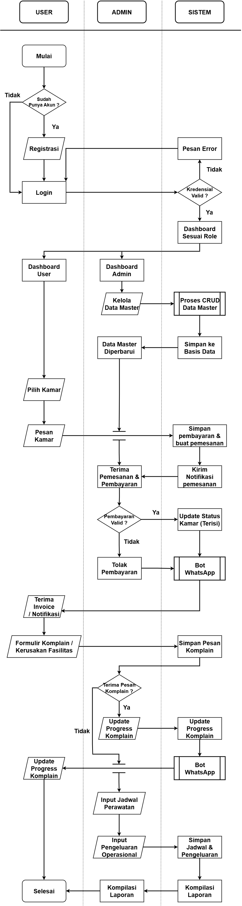
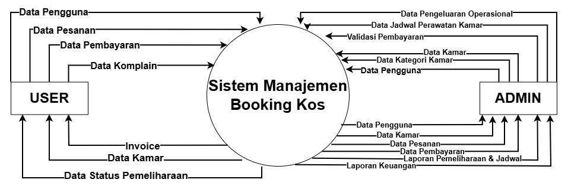
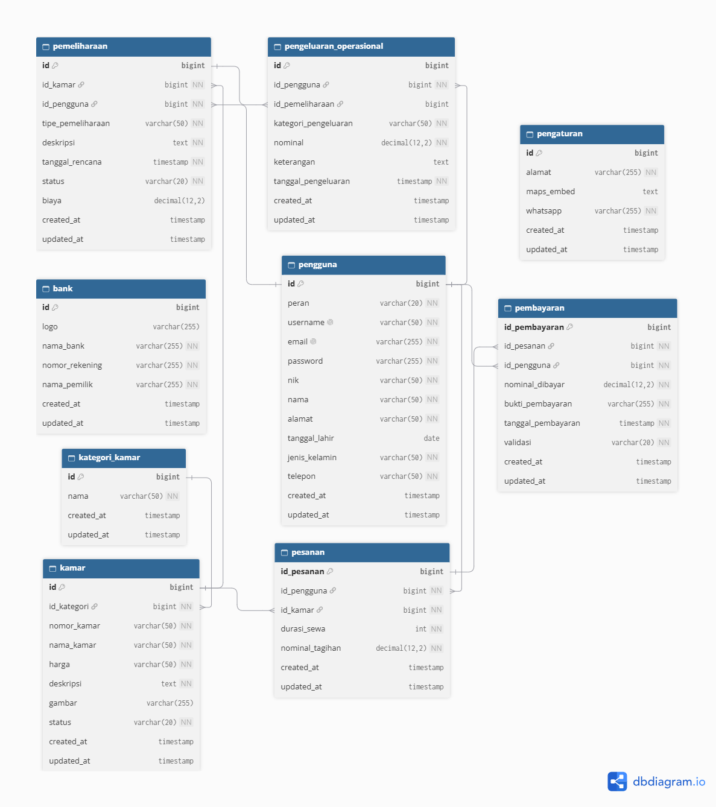

# Pemodelan Sistem & Arsitektur (System Modeling)

## Sistem Manajemen & Reservasi Kos Titik Kumpul
Dokumen ini memuat rancangan pemodelan, arsitektur aliran data, serta perancangan basis data relasional untuk sistem pemesanan kos berbasis web yang terintegrasi dengan notifikasi otomatis Bot WhatsApp.
---

## Flowchart Sistem
Diagram alur operasional sistem mendefinisikan tahapan kerja yang terbagi berdasarkan hak akses pengguna antara Admin dan User (Penyewa) secara terstruktur. 

Keterangan Alur:
- **Autentikasi Pengguna:** Pengguna baru melakukan registrasi akun jika belum terdaftar, kemudian memasukkan kredensial login yang divalidasi oleh sistem untuk menampilkan dashboard sesuai peran masing-masing.
- **Pengelolaan Data Master (Admin):** Admin mengelola data master secara berkala melalui proses CRUD yang datanya langsung diperbarui dan disimpan ke dalam basis data sistem.
- **Reservasi & Pembayaran (User):** Pengguna memilih kamar, input pemesanan dan pembayaran yang disimpan sistem, lalu admin memvalidasinya agar sistem dapat memperbarui status kamar dan mengirimkan notifikasi invoice via bot WhatsApp.
- **Manajemen Pemeliharaan & Komplain:** Pengguna dapat mengisi formulir komplain kerusakan fasilitas yang terdapat pada sistem, kemudian admin memperbarui progres penanganannya saat sudah diperbaiki atau dalam proses perbaikan agar pengguna menerima notifikasi progress pengerjaan.
- **Perawatan Rutin & Keuangan:** Admin menginput jadwal perawatan serta pengeluaran operasional yang disimpan oleh sistem untuk dikompilasi menjadi laporan akhir secara otomatis.

## Diagram Konteks
Diagram Konteks menggambarkan batasan sistem secara makro dengan memetakan interaksi data antara aktor eksternal dan sistem utama manajemen kos. 

Entitas yang terlibat :
- **User:** Mengirimkan Data User, Data Pesanan, Data Pembayaran, serta menerima informasi Data Kamar dan dokumen Invoice.
- **Admin:** Mengirimkan Data Kategori, Data Kamar, Data User, Validasi Pembayaran, serta menerima rekapitulasi laporan transaksi.

## Data Flow Diagram (DFD) Level 1
Diagram Alir Data Level 1 memetakan dekomposisi proses operasional utama sistem ke dalam subsistem fungsional yang terhubung langsung dengan *data store* internal.

Aktivitas / proses yang terlibat :
- **Proses 1.0 (Registrasi & Autentikasi):** Mengelola pendaftaran akun baru dan verifikasi login pengguna ke penyimpanan tabel `users`.
- **Proses 2.0 (Kelola Data Master):** Memungkinkan admin untuk memelihara entitas `categories`, `rooms`, dan `users`.
- **Proses 3.0 (Pesan Kos):** Memproses pengajuan pemesanan kamar oleh user dan merekam data transaksi ke tabel `pesanan`.
- **Proses 4.0 (Pembayaran):** Mengelola unggahan bukti transfer pembayaran dan pencocokan status validasi pada tabel `pembayaran`.
- **Proses 5.0 (Laporan & Modul WhatsApp):** Menghasilkan rekapitulasi laporan operasional bagi admin dan mendistribusikan invoice otomatis kepada user.

## Relasi Basis Data
Perancangan skema basis data relasional yang ternormalisasi untuk menjamin integritas dan efisiensi penyimpanan data operasional sistem reservasi kos.

Tabel Utama yang Digunakan:

- **Users:** Menyimpan informasi profil pengguna, kredensial login, nomor telepon, dan hak akses (*role*).
- **Categories:** Menyimpan data pengelompokan jenis atau tipe kamar kos.
- **Rooms:** Menyimpan detail spesifikasi fisik kamar, harga, fasilitas, gambar, serta status ketersediaan.
- **Pesanan:** Menjadi tabel transaksional pusat yang menghubungkan relasi antara pengguna, kamar, dan pembayaran.
- **Pembayaran:** Mencatat riwayat unggahan bukti bayar, nominal, tanggal, serta status validasi pembayaran.
- **Banks & Settings:** Menyimpan referensi rekening tujuan transfer pembayaran serta konfigurasi global aplikasi.